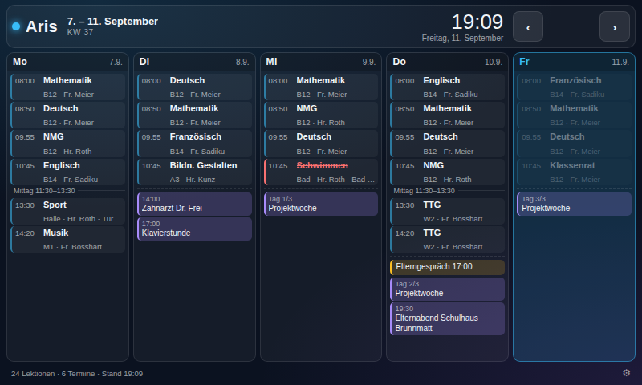

# 📚 Stundenplan & Kalender für Aris

Eine Wochenansicht für das **offizielle Raspberry Pi 7"-Touchdisplay (V1.1, 800 × 480 px)**:
links der Stundenplan, rechts daneben die Termine aus dem Familienkalender – alles auf
einen Blick, ohne Scrollen.

Der Code baut auf dem [Family Dashboard](https://github.com/kapitalist80-web/family-dashboard)
auf (gleicher Technik-Stack, gleiche Kalenderlogik), ist aber als eigenständiges,
schlankes Programm für genau diesen einen Bildschirm gebaut.



## Was die Anzeige kann

- **Ganze Woche auf einem Schirm** – Montag bis Freitag (optional mit Wochenende)
- **Stundenplan** mit Zeit, Fach, Raum, Lehrperson und Notiz
- **Kalendertermine** aus beliebig vielen iCal-Quellen (Google, iCloud, Schulkalender …),
  inklusive Serienterminen und mehrtägigen Einträgen
- **Laufende Lektion** wird hervorgehoben, vergangene ausgegraut
- **Pausen und Mittagszeit** werden automatisch aus den Lücken berechnet
- **Ausnahmen** pro Datum: „fällt aus“, „geändert“ oder ein Hinweis für den ganzen Tag
- **Automatischer Wochenwechsel**: ab Freitagabend zeigt der Schirm die kommende Woche
- **Touch-Bedienung**: wischen oder tippen für eine Woche vor/zurück, nach zwei Minuten
  springt die Anzeige von selbst auf die laufende Woche zurück
- **Automatische Schriftgröße**: je nach Anzahl Lektionen wird kompakter dargestellt,
  damit nie gescrollt werden muss
- **Nachtmodus**: der Bildschirm wird nachts abgedunkelt
- **Einstellungsseite** im Browser – kein Editieren von Dateien nötig

## Schnellstart

```bash
git clone <adresse-dieses-repositorys> aris-stundenplan
cd aris-stundenplan

npm install
cp config.example.json config.json   # Beispiel-Stundenplan als Startpunkt
npm start
```

Danach im Browser öffnen:

| Seite | Adresse |
|-------|---------|
| Anzeige | http://localhost:3100 |
| Einstellungen | http://localhost:3100/settings |

Der Beispiel-Stundenplan in `config.example.json` ist erfunden – er dient nur dazu,
dass die Anzeige beim ersten Start nicht leer ist. Eigene Daten am besten direkt
über die Einstellungsseite erfassen.

## Installation auf dem Raspberry Pi

### 1. Node.js installieren

```bash
sudo apt update && sudo apt upgrade -y
curl -fsSL https://deb.nodesource.com/setup_20.x | sudo -E bash -
sudo apt install -y nodejs git
```

### 2. Projekt einrichten

```bash
cd ~
git clone <adresse-dieses-repositorys> aris-stundenplan
cd aris-stundenplan
./setup-pi.sh
```

`setup-pi.sh` erledigt alles Weitere:

- installiert die Abhängigkeiten
- legt `config.json` an (falls noch nicht vorhanden)
- richtet den systemd-Dienst `aris-stundenplan` ein und startet ihn
- trägt Chromium im Kiosk-Modus in den Autostart ein
- schaltet Bildschirmschoner und Energiesparmodus ab

Nach einem Neustart zeigt der Pi die Wochenansicht im Vollbild.

Nützliche Befehle:

```bash
systemctl status aris-stundenplan      # läuft der Dienst?
journalctl -u aris-stundenplan -f      # Logausgabe mitlesen
sudo systemctl restart aris-stundenplan
```

### 3. Zeitzone prüfen

Die Anzeige rechnet Termine in die konfigurierte Zeitzone um (Standard `Europe/Zurich`).
Der Pi selbst sollte dieselbe Zeitzone verwenden:

```bash
sudo raspi-config    # Localisation Options -> Timezone
timedatectl          # Kontrolle
```

## Hinweise zum Display V1.1

Das offizielle 7"-Touchdisplay hat **800 × 480 Pixel** – genau darauf ist das Layout
ausgelegt. Die Anzeige nutzt die volle Fläche und kommt ohne Scrollbalken aus.

**Bild drehen** (wenn das Display kopfüber montiert ist), in `/boot/firmware/cmdline.txt`
am Ende der ersten Zeile ergänzen:

```
video=DSI-1:800x480@60,rotate=180
```

Auf älteren Systemen (Bullseye, ohne KMS) stattdessen in `/boot/firmware/config.txt`:

```
display_lcd_rotate=2
```

Damit auch die **Touch-Eingabe** mitdreht, unter Wayland (Raspberry Pi OS Bookworm):

```bash
wlr-randr --output DSI-1 --transform 180
```

**Helligkeit** setzen (0–255, Pfad je nach Kernel-Version):

```bash
echo 80 | sudo tee /sys/class/backlight/10-0045/brightness
# ältere Kernel:
echo 80 | sudo tee /sys/class/backlight/rpi_backlight/brightness
```

Wer den Bildschirm nachts ganz ausschalten möchte, kann das per Cron erledigen:

```cron
0 21 * * * echo 0   | sudo tee /sys/class/backlight/10-0045/bl_power
0  7 * * * echo 1   | sudo tee /sys/class/backlight/10-0045/bl_power
```

Der eingebaute **Nachtmodus** (Einstellungen → Kind & Anzeige) dunkelt den Inhalt
softwareseitig ab und braucht keine Root-Rechte.

## Bedienung am Touchscreen

| Geste / Taste | Wirkung |
|---------------|---------|
| Wischen nach links / rechts | eine Woche vor / zurück |
| `‹` `›` | eine Woche vor / zurück |
| `Heute` | zurück zur laufenden Woche |
| Pfeiltasten ← → | Woche wechseln (Tastatur) |
| `R` | Kalenderdaten sofort neu laden |
| `M` | Mauszeiger ein-/ausblenden |
| Zahnrad unten rechts | Einstellungen öffnen |

Nach zwei Minuten ohne Bedienung springt die Anzeige automatisch auf die
aktuelle Woche zurück.

## Einstellungen

Alles wird unter `/settings` gepflegt und in `config.json` gespeichert.

### Kind & Anzeige

| Feld | Bedeutung |
|------|-----------|
| Name, Farbe | Beschriftung oben links |
| Sprache/Region, Zeitzone | Format von Datum und Uhrzeit |
| Aktualisierung | wie oft die Kalender neu geladen werden (Minuten) |
| Wochenende zeigen | 5 oder 7 Spalten |
| Nächste Woche ab | ab wann automatisch auf die Folgewoche gewechselt wird |
| Nachtmodus | Zeitraum und Stärke der Abdunklung |

### Stundenplan

Pro Wochentag beliebig viele Lektionen mit Von/Bis, Fach, Raum, Lehrperson und Notiz.
Mit *Tag kopieren nach …* lässt sich ein Tag auf einen anderen übertragen.
Über *Export/Import (JSON)* kann der Plan gesichert und wieder eingespielt werden.

### Kalender

iCal-Adresse eintragen, fertig. `webcal://` wird automatisch zu `https://` umgeschrieben.

- **Google Kalender**: Einstellungen → Kalender → *Geheime Adresse im iCal-Format*
- **iCloud**: Kalender freigeben → *Öffentlicher Kalender* → Link kopieren

Die Adressen sind Zugänge zu privaten Daten – sie landen in `config.json`,
die per `.gitignore` bewusst **nicht** eingecheckt wird.

### Ausnahmen

Für einzelne Daten: *fällt aus*, *geändert* oder *Hinweis*.
Bleibt das Feld „Fach“ leer, gilt die Ausnahme für den ganzen Tag.
*Alte entfernen* räumt vergangene Einträge weg.

## API

| Endpunkt | Beschreibung |
|----------|--------------|
| `GET /api/week?offset=0` | komplette Wochenansicht (Stundenplan + Termine) |
| `GET /api/config` · `PUT /api/config` | Kind- und Anzeigeeinstellungen |
| `GET /api/timetable` · `PUT /api/timetable` | Stundenplan lesen/schreiben |
| `GET /api/calendars` · `POST` · `PUT /:id` · `DELETE /:id` | Kalenderquellen |
| `GET /api/exceptions` · `POST` · `DELETE /:id` · `POST /cleanup` | Ausnahmen |
| `POST /api/refresh` | Kalender-Cache leeren |
| `GET /api/health` | Statusabfrage |

`offset` verschiebt die angezeigte Woche (`-1` = letzte, `1` = nächste Woche).

## Aufbau des Codes

```
server.js                 Express-Server
src/config.js             Konfiguration laden, ergänzen, speichern
src/week.js               Datums- und Wochenlogik (KW, Wochenwechsel, Tagesraster)
src/timetable.js          Stundenplan eines Tages inkl. Ausnahmen
src/calendar.js           iCal abholen, Serien auflösen, Termine auf Tage verteilen
src/routes.js             API-Endpunkte
public/index.html         Wochenansicht (800 × 480)
public/settings.html      Einstellungsseite
tests/                    Tests für Wochenlogik, Stundenplan und Kalender
```

Tests laufen ohne Netzwerkzugriff:

```bash
npm test
```

## Als eigenes Repository veröffentlichen

Dieser Ordner ist ein vollständiges, eigenständiges Projekt. Um daraus ein eigenes
Repository zu machen:

```bash
cp -r aris-week ~/aris-stundenplan
cd ~/aris-stundenplan
git init -b main
git add .
git commit -m "Stundenplan- und Kalenderanzeige für das Raspberry Pi Display"
git remote add origin git@github.com:<benutzer>/aris-stundenplan.git
git push -u origin main
```

Da im Repository ein Stundenplan und Kalenderadressen eines Kindes landen können,
ist ein **privates** Repository empfehlenswert. `config.json` und `.env` sind
vorsorglich in `.gitignore` eingetragen.

## Technik

- **Backend**: Node.js 18+ mit Express
- **Kalender**: `node-ical` und `rrule` für Serientermine
- **Frontend**: reines HTML/CSS/JavaScript, keine Build-Schritte, keine externen CDNs
- **Datenhaltung**: eine einzige `config.json`

## Lizenz

MIT
